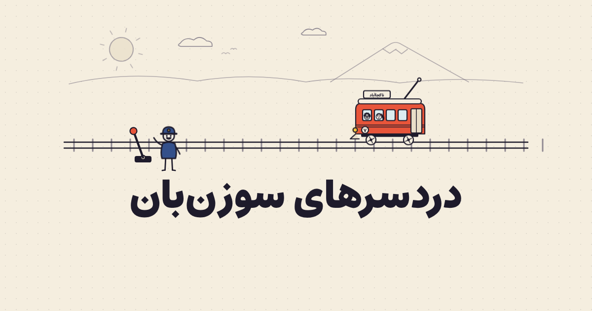

# 🚋 دردسرهای سوزن‌بان

نسخه‌ی فارسی و ایرانی‌شده‌ی بازی «مسئله‌ی تراموا»: هر مرحله یک دوراهی اخلاقی عجیب است. اهرم دست شماست — می‌کشید یا کاری نمی‌کنید؟ بعد از هر تصمیم می‌بینید چند درصد مردم با شما هم‌نظر بوده‌اند.



## ویژگی‌ها

- **۲۹ مرحله**: ترکیبی از سناریوهای کلاسیک (با چاشنی فارسی) و سناریوهای کاملاً ایرانی؛ از چای تازه‌دم و ته‌دیگ تا دربی، صف نانوایی، تعارف و فیلترشکن.
- **تصویرسازی وکتور خطی** که همه با کد و به صورت SVG ساخته می‌شوند (`public/js/art.js`)؛ آدم‌ها مثل نسخه‌ی اصلی روی ریل بسته شده‌اند.
- **انیمیشن‌ها**: لودر، «طراحی با قلم» هر صحنه، ورود قطار، فنر اهرم، حرکت قطار روی پیچ و حلقه، پرتاب، حباب «شَتَلَق!»، لرزش صفحه، ذرات، شمارنده‌ها و نمودار دایره‌ای، کاغذرنگی پایانی و ترنزیشن بین مرحله‌ها.
- **میکروانیمیشن‌ها**: لرزیدن آدم‌ها از ترس، پیش‌نمایش مسیر با هاور روی دکمه‌ها، بخار چای، دود قطار، ابر و پرنده و…
- **صدا**: همه‌ی افکت‌ها با Web Audio ساخته می‌شوند (بدون فایل صوتی) و قابل قطع‌اند.
- **رأی‌گیری زنده**: هر نشست برای هر مرحله یک رأی دارد (با تغییر نظر، رأی قبلی جابه‌جا می‌شود)؛ درصد موافق/مخالف و تعداد کل رأی‌ها نمایش داده می‌شود.
- **جمع‌بندی پایانی**: تعداد کل تلفات، «تیپ اخلاقی» شما، فهرست تصمیم‌ها و اشتراک‌گذاری نتیجه.
- راست‌به‌چپ کامل، فونت [استعداد](https://fonts.google.com/specimen/Estedad) (روی خود سرور میزبانی می‌شود)، اعداد فارسی، حالت تاریک، موبایل، کیبورد (۱/۲ برای انتخاب، Enter برای بعدی) و احترام به `prefers-reduced-motion`.

## اجرا

نیازمندی: Node.js نسخه‌ی **22.13 یا بالاتر** (از SQLite داخلی Node استفاده می‌شود؛ هیچ وابستگی npm ندارد).

```bash
npm start          # http://localhost:3000
npm run dev        # با ری‌لود خودکار
npm test           # تست‌های API و داده‌ی مرحله‌ها
```

### با Docker

```bash
docker compose up -d --build
```

رأی‌ها در volume به نام `votes` (مسیر `/data/votes.db`) نگه داشته می‌شوند.

### متغیرهای محیطی

| متغیر | پیش‌فرض | توضیح |
|---|---|---|
| `PORT` | `3000` | پورت سرور |
| `HOST` | `0.0.0.0` | آدرس گوش دادن |
| `DB_PATH` | `data/votes.db` | مسیر فایل SQLite |
| `TRUST_PROXY` | — | پشت Apache/LiteSpeed/nginx: `1` (آخرین مقدار `X-Forwarded-For`) — پشت Cloudflare: `cloudflare` |
| `VOTE_LIMIT` | `120` | حداکثر رأی هر IP در دقیقه |
| `REGION` | `main` | `ir` یا `intl` |
| `ALT_URL` | — | آدرس نسخه‌ی دیگر (برای هدایت و لینک) |
| `GEO_REDIRECT` | — | `1` برای هدایت خودکار بر اساس کشور |
| `SYNC_SECRET` | — | کلید مشترک دو سرور (حداقل ۲۴ کاراکتر) |
| `SYNC_PEER` | — | فقط روی سرور ایران: آدرس سرور اروپا |
| `SYNC_INTERVAL` | `300` | فاصله‌ی همگام‌سازی به ثانیه |

متغیرها را می‌توانید در فایل `.env` در ریشه‌ی پروژه هم بگذارید.

## دو نسخه: ایران و بین‌الملل

برای اینکه بازی در زمان قطعی اینترنت بین‌الملل هم برای کاربران داخل و هم خارج از ایران کار کند، دو نسخه‌ی مستقل اجرا می‌شود:

| | نسخه‌ی بین‌الملل | نسخه‌ی ایران |
|---|---|---|
| دامنه | `soozanban.com` | `souzanbaan.ir` (با DNS داخل ایران) |
| سرور | اروپا | ایران |
| `REGION` | `intl` | `ir` |

- **هدایت خودکار:** هر سرور از روی IP (فهرست محلی بازه‌های IP ایران در `server/geo/`) تشخیص می‌دهد کاربر کجاست و اگر نسخه‌ی دیگر مناسب‌تر و در دسترس باشد، کاربر را همراه با شناسه و پیشرفت بازی‌اش به آن منتقل می‌کند. کسی که یک بار منتقل شده دوباره جابه‌جا نمی‌شود. در صفحه‌ی اول هم لینک نسخه‌ی دیگر نمایش داده می‌شود.
- **همگام‌سازی:** سرور ایران هر چند دقیقه رأی‌ها را با سرور اروپا ادغام می‌کند (هر دو جهت). اگر ارتباط قطع باشد، هر نسخه مستقل کار می‌کند و بعد از وصل شدن، همگام‌سازی از همان‌جا که مانده ادامه پیدا می‌کند. در تداخل، رأی جدیدتر برنده است و آمار از روی خود رأی‌ها شمرده می‌شود، پس چیزی دو بار حساب نمی‌شود.
- **صف رأی آفلاین:** اگر ارسال رأی ناموفق باشد، در مرورگر نگه داشته و بعداً فرستاده می‌شود.
- **بدون وابستگی خارجی:** فونت، داده‌ی IP و همه‌ی فایل‌ها روی خود سرور است.

تنظیمات هر سرور در `deploy/env.ir.example` و `deploy/env.intl.example` آمده و راهنمای کامل استقرار روی سرورهای cPanel در [`deploy/BRIEF.md`](deploy/BRIEF.md) است.

```bash
npm run sync        # یک دور همگام‌سازی دستی (روی سرور ایران)
npm run backup      # پشتیبان از دیتابیس در data/backups (۱۴ نسخه‌ی آخر)
npm run update-geo  # به‌روزرسانی فهرست IP ایران (روی سیستمی با دسترسی به گیت‌هاب؛ سپس commit)
```

## API

| مسیر | توضیح |
|---|---|
| `GET /api/stats` | آمار همه‌ی مرحله‌ها: `{ levels: { id: { pull, stay } }, players }` |
| `POST /api/vote` | بدنه: `{ session, level, choice: "pull" \| "stay" }` ← آمار به‌روز همان مرحله |
| `GET /api/whereami` | منطقه‌ی این سرور، کشور کاربر و پیشنهاد نسخه‌ی مناسب |
| `GET /healthz` | سلامت سرور |
| `GET /api/sync/changes` · `POST /api/sync/apply` · `GET /api/sync/status` · `POST /api/sync/run` | همگام‌سازی بین دو سرور — فقط با `Authorization: Bearer <SYNC_SECRET>` |

## ساختار پروژه

```
server/index.js      سرور HTTP: فایل‌های ایستا (با gzip و ETag) + API + محدودیت نرخ
server/db.js         ذخیره‌ی رأی‌ها در SQLite (+ تغییرات برای همگام‌سازی)
server/sync.js       همگام‌ساز دوطرفه با سرور دیگر
server/geo.js        تشخیص IP ایران (server/geo/ir-ipv4.txt و ir-ipv6.txt)
server/config.js     تنظیمات از متغیرهای محیطی / .env
deploy/              نمونه‌ی .env، سرویس systemd، پراکسی cPanel، اسکریپت انتشار و راهنمای استقرار
public/index.html    پوسته‌ی صفحه و لودر
public/css/style.css استایل‌ها و انیمیشن‌های CSS
public/js/levels.js  متن و چیدمان مرحله‌ها (سرور هم از آن برای اعتبارسنجی استفاده می‌کند)
public/js/art.js     کتابخانه‌ی تصویرسازی SVG: آدم‌ها، اشیا، قطار، سوزن‌بان
public/js/scene.js   ساخت صحنه، طراحی با قلم، حرکت قطار و برخوردها
public/js/audio.js   افکت‌های صوتی Web Audio
public/js/app.js     جریان بازی، نتیجه‌ها و صفحه‌ی پایانی
```

## افزودن مرحله‌ی جدید

یک شیء به آرایه‌ی `LEVELS` در `public/js/levels.js` اضافه کنید:

```js
{
  id: 'my-level',                       // شناسه‌ی یکتا (برای رأی‌ها)
  title: 'عنوان مرحله',
  text: 'متن سناریو…',
  top:    { label: 'برچسب ریل بالا', items: [{ k: 'person', n: 5 }] },   // اگر کاری نکنید
  bottom: { label: 'برچسب ریل پایین', items: [{ k: 'tea' }] },          // اگر اهرم را بکشید
  labels: { pull: 'متن دکمه‌ی کشیدن', stay: 'متن دکمه‌ی کاری نکن' },   // اختیاری
}
```

نوع آیتم‌ها (`k`) در شیء `ITEMS` فایل `art.js` تعریف شده‌اند. برای دیدن مستقیم یک مرحله: `/#level-7`.

> ایده‌ی بازی از [Absurd Trolley Problems](https://neal.fun/absurd-trolley-problems/) ساخته‌ی Neal Agarwal گرفته شده است؛ متن‌ها، تصویرسازی و کد این پروژه از نو ساخته شده‌اند.
